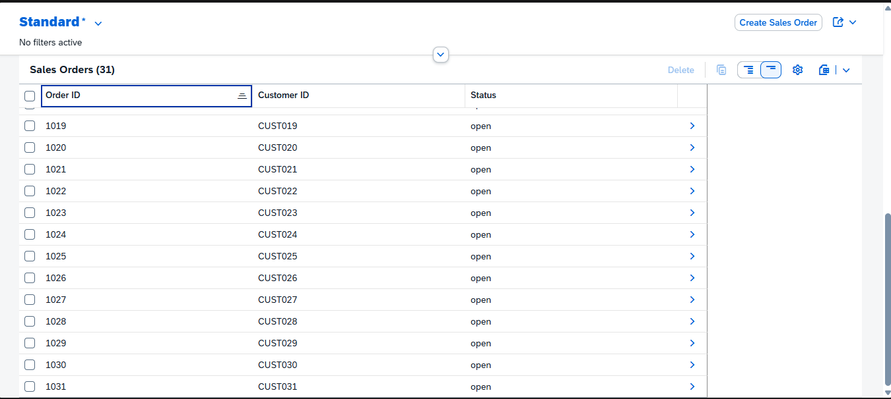
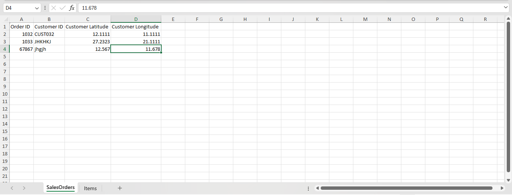
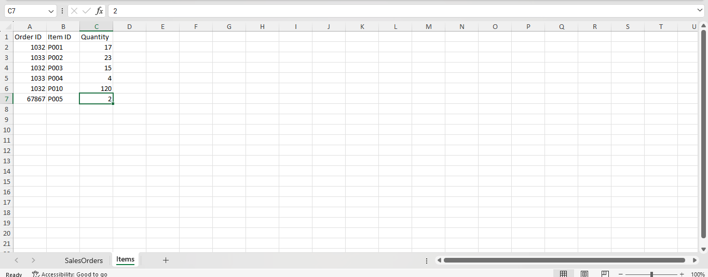
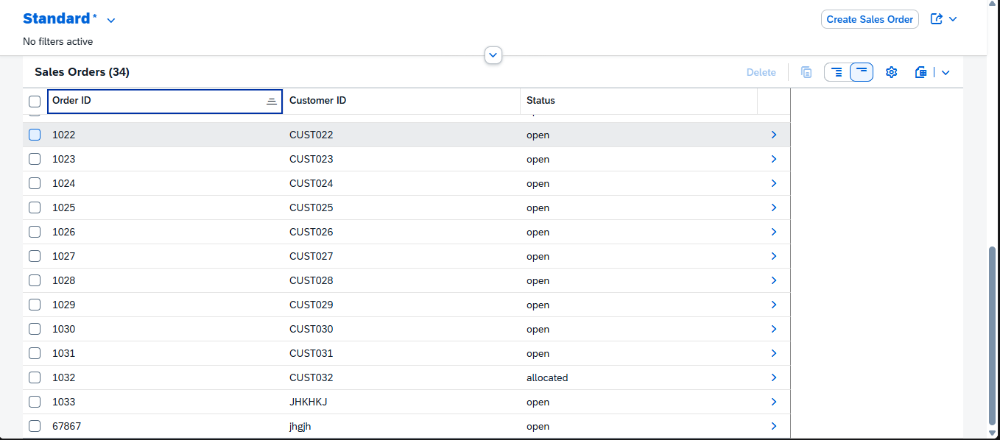
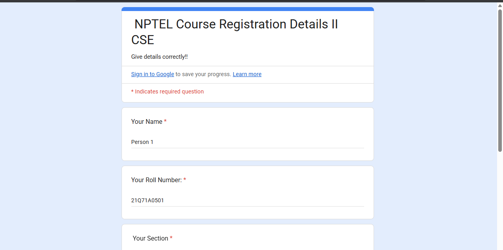
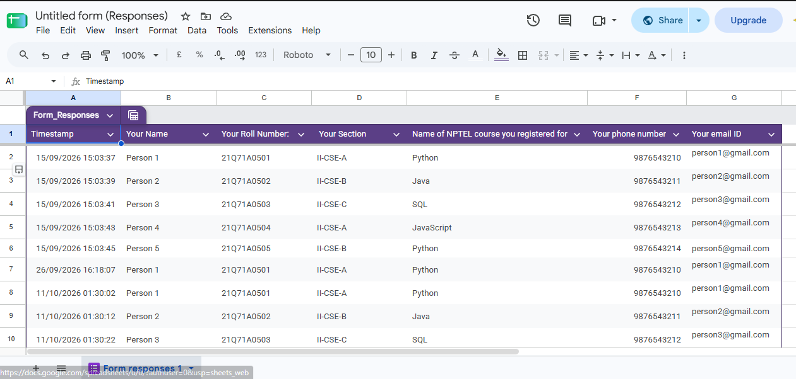

# Playwright Automation Project

A Node.js project for experimenting with browser automation using Playwright. It includes a SmartWarehouse Create Sales order, a form automation test using a small SQLite student lookup example.

##  Tests & Repo Features

- **SmartWarehouse Create Sales order** — reads sales orders and their items from an Excel workbook, converts them to JSON, and starts the Playwright test.
- [View and download the SmartWarehouse SAP CAPm project on GitHub](https://github.com/Harikesh-Das/SmartWarehouse-SAP_CAPm)
- **Google Form Submission** - reads student data form `databases/students.db` and runs a loop which responds to a Google form.
- **Playwright tests** — test files are located in `tests/`.
- **Brave browser support** — the Playwright configuration uses a local Brave executable.
- **SQLite example** — creates/imports student records from CSV and looks up a student by ID.

## Tech Stack

- Node.js (ES modules)
- Playwright Test
- Brave Browser
- `xlsx` for reading Excel workbooks
- `better-sqlite3` for SQLite access

## Prerequisites

- Install Node.js and npm.
- Install Brave Browser, or update `playwright.config.js` to point to a supported browser executable.
- Have access to the application and test data required by the test you want to run.

## Setup

1. Clone or download this repository.
2. Open a terminal in the project directory.
3. Install dependencies:

   ```bash
   npm install

   ```
   Check `playwright.config.js`. The current configuration points to Brave at:

`C:\Program Files\BraveSoftware\Brave-Browser\Application\brave.exe`

Change this path if Brave is installed elsewhere.

## Running the Tests

Run all tests:

```bash
npx playwright test
```

Run a specific test file:

```bash
npx playwright test tests/smartwarehouse.spec.js
npx playwright test tests/form.spec.js
```

Run tests with the browser visible:

```bash
npx playwright test --headed
npx playwright test filename.spec.js
```

Open the HTML report after a test run:

```bash
npx playwright show-report
```

## SmartWarehouse Create Sales Order

Run the input script:

```bash
node input.js
```

When prompted in Terminal, enter the path to an Excel workbook. The workbook is expected to contain these sheets and columns:

### `SalesOrders` Sheet

| Column | Purpose |
|---|---|
| `Order ID` | Sales order identifier |
| `Customer ID` | Customer identifier |
| `Customer Latitude` | Customer latitude |
| `Customer Longitude` | Customer longitude |

### `Items` Sheet

| Column | Purpose |
|---|---|
| `Order ID` | Links an item to a sales order |
| `Item ID` | Item/product identifier |
| `Quantity` | Requested quantity |

The script groups item rows by `Order ID`, creates `order-input.json`, then launches the SmartWarehouse Playwright test in headed mode. Keep the workbook column names consistent with the names above.

## Google Form Submission

The `databases/` directory contains a CSV file, SQLite database, and database scripts.

- `databases/db.js` creates the `students` table and imports rows from `students.csv`.
- `databases/getStudent.js` queries a student by ID.
- `tests/form.spec.js` runs a predetermined for loop to enter students details and submit form for each student

## Project Structure

```text
.
├── databases/
│   ├── db.js
│   ├── getStudent.js
│   ├── students.csv
│   └── students.db
├── tests/
│   ├── example.spec.js
│   ├── form.spec.js
│   └── smartwarehouse.spec.js
├── input.js
├── playwright.config.js
├── order-input.json
├── input.xlsx
├── package.json
└── README.md
```
## Running Tests on Chrome, Edge, and Firefox

Install the required Playwright browsers:

```bash
npx playwright install chromium firefox

To install all supported browsers:

```bash
npx playwright install
```

### Chrome (Chromium)

```bash
npx playwright test --project=chromium
```

### Microsoft Edge

```bash
npx playwright test --project=msedge
```

### Firefox

```bash
npx playwright test --project=firefox
```

### Run a Specific Test on Each Browser

```bash
npx playwright test tests/form.spec.js --project=chromium
npx playwright test tests/form.spec.js --project=msedge
npx playwright test tests/form.spec.js --project=firefox
```

### Run Tests with the Browser Visible

```bash
npx playwright test --project=chromium --headed
npx playwright test --project=msedge --headed
npx playwright test --project=firefox --headed
```

**Note:** The browser project names must be configured in `playwright.config.js`. If your configuration currently uses only Brave, add separate projects for Chromium, Edge, and Firefox before running these commands.

Playwright's bundled Chromium is not the same as Google Chrome. To use the installed Google Chrome or Microsoft Edge browser, configure the appropriate browser channel in `playwright.config.js`.

## Screenshots

### SmartWarehouse Automation

The SmartWarehouse automation reads sales order and item details from an Excel workbook, converts the data into JSON, and runs the Playwright test to automate warehouse allocation.

**1. Sales Orders List Report**



**2. SalesOrders Excel Sheet**

Contains order IDs, customer IDs, and customer coordinates.



**3. Items Excel Sheet**

Contains order IDs, item IDs, and requested quantities.



**4. Allocation Result**

Shows the updated Sales Orders list after the allocation workflow.



### Google Form Automation — `form.spec.js`

The `form.spec.js` test automates interaction with the NPTEL Course Registration Google Form using Playwright.

**5. Registration Form**



**6. Form Responses**



